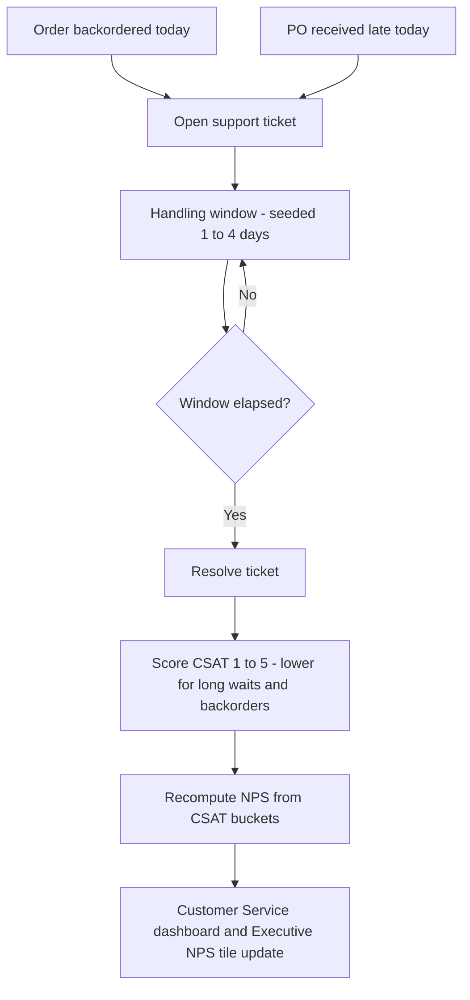

# Process Flow — Supplier Miss → Customer Service → NPS

How an upstream supply problem becomes a measured customer-sentiment outcome. This loop
runs every day, downstream of the order and procurement flows.

## Reading the diagram

- The two entry points (**backorder**, **late PO**) are the exact signals the
  operations simulation already emits — this problem consumes them, it does not invent
  new demand.
- CSAT is where **experience** enters the model; **NPS** is the leadership-facing
  roll-up (`%promoters − %detractors`).
- Because both entry points trace to supplier reliability and stock levels, a movement
  in NPS is always explainable by the operational events in the same system log.
