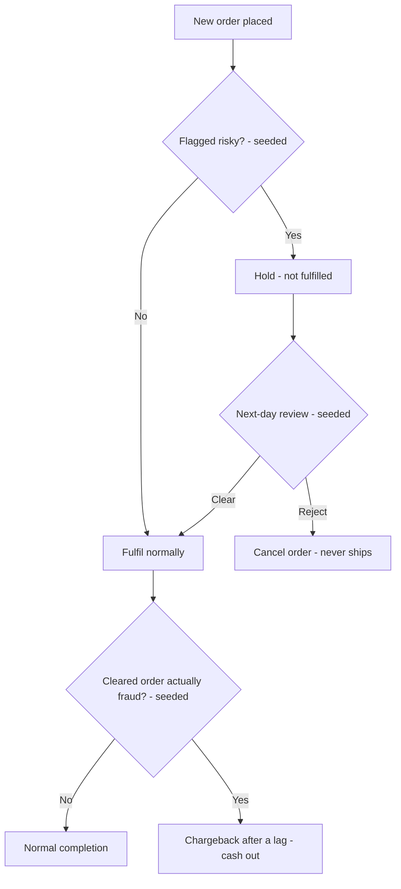

# Process Flow — Order → Risk Review → Fulfil or Reject

The control point between capturing an order and shipping it. A flagged order is held,
reviewed the next day, and either proceeds or is stopped — and fraud that slips through is
caught later as a chargeback.

## Reading the diagram

- The **hold** is the gate: a flagged order cannot ship until a human-in-the-loop review
  clears it — the one place this platform stops the order flow rather than just observing
  it.
- **Reject** prevents loss up front; **chargeback** measures the loss that slips through
  when a fraudulent order is cleared in error.
- Because held/rejected counts and chargebacks roll into the KPIs, a dip in cash is
  explainable by the fraud events in the same system log.
