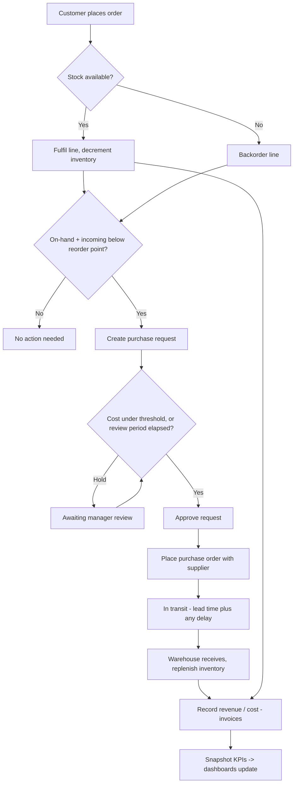

# Process Flow — Order-to-Cash meets Procure-to-Pay

The end-to-end loop the simulation runs every day. One customer order can ripple
all the way through to a replenished shelf and an updated executive KPI.

## Reading the diagram

- The **left branch** (order → fulfil/backorder) is Order-to-Cash.
- The **right branch** (reorder → request → approval → PO → receipt) is
  Procure-to-Pay.
- They meet at **Finance** and **KPIs**, which is why a single dashboard number is
  traceable back through the whole chain.
