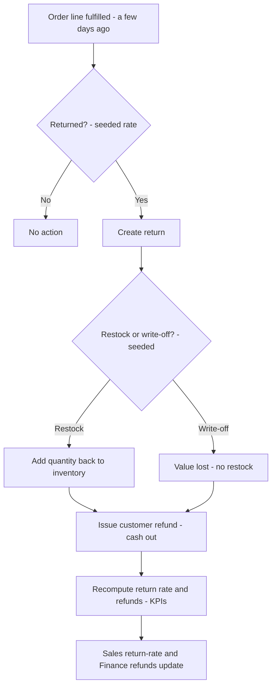

# Process Flow — Sale → Return → Reverse Logistics

What happens after the sale. A fulfilled order line, a few days later, may come back —
and when it does, it touches Warehouse, Inventory, and Finance in one pass.

## Reading the diagram

- The entry point is a **past fulfilled sale**, so returns are always tied to real
  earlier demand — the reverse side of Order-to-Cash.
- **Restock** recovers inventory value; **write-off** does not — but both **refund** the
  customer, so cash always moves.
- Because return rate and refunds roll into the daily KPIs, a dip in cash or margin is
  explainable by the returns in the same system log.
