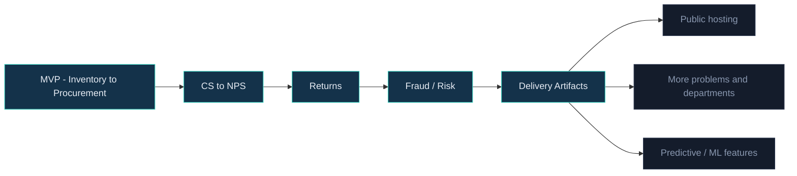

# Product Roadmap — Enterprise360

Delivered increments and what's next. Each problem is an independent, shippable slice that
extends the same running company.

## Now (shipped)

- **MVP** — the flagship Order-to-Cash × Procure-to-Pay loop and five dashboards.
- **CS → NPS**, **Returns**, **Fraud / Risk** — three connected problems.
- **Delivery artifacts** — this PM/Agile package.

## Next (candidates, not committed)

- **Public hosting** — swap SQLite for Postgres and deploy for a shareable live demo.
- **More problems / departments** — e.g. HR, Marketing, or a supplier-scorecard problem.
- **Predictive features** — demand forecasting or a churn/fraud model over the sim data.
